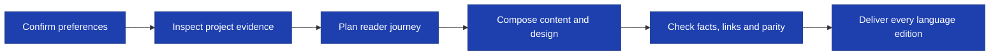

<h1 align="center">General README Skill</h1>
<p align="center">
  <strong>Create and update evidence-based README files with AI coding assistants</strong>
  <br />
  <em>v2.0.0 · Preference Confirmation · Git-Aware Updates · Multi-Platform · Multi-Language</em>
</p>

<p align="center">
  <a href="#quick-start"></a>
  <a href="LICENSE"></a>
</p>

<p align="center">
  <a href="install/claude-code.md"></a>
  <a href="install/copilot.md"></a>
  <a href="install/cursor.md"></a>
</p>

<p align="center">
  English · <a href="assets/README-zh.md">中文</a> · <a href="assets/README-ja.md">日本語</a> · <a href="assets/README-ko.md">한국어</a> · <a href="assets/README-ru.md">Русский</a>
</p>

<p align="center">
  
</p>

## Quick Start

This repository (directory `general-readme-skill`) provides two skills: **`readme-write`** creates README files and **`readme-update`** keeps them current from Git changes. The core workflow uses native agent read/search/edit tools. The optional offline checkers need **Python 3.9+** and no third-party packages.

### Install readme-write

Copy `SKILL.md`, `references/` and `scripts/` together into a skill directory named `readme-write`. Keep their relative paths intact; installing only `SKILL.md` leaves the workflow incomplete.

```bash
mkdir -p .claude/skills/readme-write
cp SKILL.md .claude/skills/readme-write/
cp -r references/ scripts/ .claude/skills/readme-write/
```

For another target project, use that project's absolute skill directory as the destination and do not overwrite existing team instructions. See the integration guides: [Claude Code](install/claude-code.md), [GitHub Copilot](install/copilot.md), [Cursor](install/cursor.md). They describe file placement; host loading must be verified in the installed host. Natural-language invocation is the portable option; `/readme-write` and `/readme` are trigger phrases, not guaranteed slash commands.

### Get the first result

Ask the host agent:

> Write a README for this project

The first response bundles the unresolved preferences and **stops until you answer**. Reply with your choices or “use the recommended settings”. After acceptance, the agent inspects static project evidence, writes the agreed README files, and reports what was checked.

To delegate choices explicitly:

> Generate the README without asking. English, for developers, balanced layout; you decide the rest.

Delegation does not authorize deleting manual content or running project install or start commands.

## What 2.0 Changes

| User pain | Upgrade |
|---|---|
| The agent forgets to ask preferences | An entry gate requires an actual reply or explicit delegation before scanning or generation |
| Attractive but unusable setup instructions | Commands, working directories and the first example must have project evidence |
| Every README looks the same | Compact, balanced and showcase layouts with relevant badges only |
| No diagram, or an invented one | Every README gets a source-backed flowchart |
| Translations drift apart | All language editions stay identical apart from the language |
| Updates pile up at the top or bottom | Each change is placed at its natural position |
| Updating destroys maintainer text | Paired managed regions; unmarked text is treated as manual |

The skills are instructional, not an enforcement engine. The gates and evaluation cases reduce omission risk; actual agent compliance still needs host-level testing.

## Preferences

Choose independently instead of accepting an all-purpose template:

| Preference | Options |
|---|---|
| Language | Primary language plus only requested translations |
| Reader | Users, developers or contributors |
| Layout | Compact, balanced or showcase |
| Depth | Short, standard or detailed |
| Tone | Professional, minimal or energetic |
| Badges | None, flat, flat-square or for-the-badge |
| Images | None or relevant existing assets; the flowchart is always included |
| Updates | Preserve by default; rewrite only within authorized scope |
| Rendering | GitHub or portable Markdown |
| Emoji | Off unless explicitly requested |

The proposed baseline is the request's language, users, balanced, standard, professional, flat, existing images, preserve and GitHub. **Recommendations are not consent.** “Make it beautiful” does not authorize silently choosing all defaults. `--no-beautify` selects the compact layout only; `--yes`, “use defaults” or “you decide” delegate unresolved preferences.

## Design That Serves the Reader

| Layout | Best fit | Presentation |
|---|---|---|
| **Compact** | Small libraries and CLIs | Left-aligned Markdown, code early, at most 2 badges |
| **Balanced** | Most repositories | Clear title and next action, at most 4 badges, one useful image |
| **Showcase** | Products with a real demo | Optional centered Hero, text action links, one genuine screenshot |

Tone is separate from layout: professional does not mean centered HTML, and energetic does not mean emoji. A real screenshot helps; a fictional UI does not. Every layout includes the flowchart, and the assistant that wrote the document is not automatically a supported platform badge.

## Workflow

The `readme-write` skill follows **Confirm → Inspect → Plan → Compose → Check → Deliver**:



1. **Confirm:** ask once, wait, then summarize the resolved preferences.
2. **Inspect:** read manifests, entry points, examples, tests and relevant config; never run project code or read real credentials.
3. **Plan:** choose a first-result path, the flowchart and only useful sections.
4. **Compose:** write content and design together in every language from one canonical structure.
5. **Check:** trace factual claims, links, anchors, markers, the flowchart and parity.
6. **Deliver:** edit only agreed files and report the checks actually performed.

The entry point is [`SKILL.md`](SKILL.md); detailed protocols live in [`references/`](references/).

## Update Skill

The companion [`readme-update`](side-skills/readme-update-skill/SKILL.md) skill (source directory `side-skills/readme-update-skill`) updates existing READMEs from local Git changes:


### Install readme-update

From this repository's root, for a project-level Claude Code installation:

```bash
mkdir -p .claude/skills/readme-update
cp side-skills/readme-update-skill/SKILL.md .claude/skills/readme-update/
cp -r side-skills/readme-update-skill/references side-skills/readme-update-skill/scripts .claude/skills/readme-update/
```

Ask “update README”. The agent first asks for the target project version, with an explicit **keep unchanged** option, and waits before editing; “you decide” does not waive it, and a version you already stated is not asked again. It then inspects committed, staged, unstaged and untracked changes with local read-only Git commands and maps public changes to the sections they affect.

Each change is **woven into the section where it belongs**, next to its closest sibling and following that section's ordering. Nothing is appended to the top or bottom just because that is easy, and no update log is added. Version scope defaults to README-only: no manifest edits, tags, commits or releases. The fallback Git baseline is the last primary README change, labeled a heuristic. See the [Git protocol](side-skills/readme-update-skill/references/git-delta.md), [version rules](side-skills/readme-update-skill/references/version-and-language-sync.md) and [placement rules](side-skills/readme-update-skill/references/placement-and-parity.md).

## Language Parity and Flowcharts

Two rules hold for every README written or updated by either skill:

1. **Always a flowchart.** Every README contains a source-backed flowchart of the real primary flow. When relationships cannot be proven, it shows the verified install, configure, run and result workflow. A preference of no images removes images, not the flowchart.
2. **Identical editions.** Every language edition has the same sections, tables, code blocks, flowchart nodes and edges, links, images and badges. Only the language differs; edition-specific content is never kept.

Diverged editions are brought to one canonical structure, and the structure is verified with the checker below. Parity checking proves structural identity only; translation accuracy still needs a human read.

## Safe Updates

For maintenance routed to `readme-update`, an actual version decision permits narrow source-backed edits in unmarked sections, not a rewrite. Explicit manual blocks and unrelated content stay protected. New generated sections use stable paired markers:

```markdown
<!-- readme-skill:begin usage -->
## Usage

Project-specific content.
<!-- readme-skill:end usage -->
```

Update only the managed span; preserve text outside it and explicit `MANUAL-START` / `MANUAL-END` blocks. Unmarked existing sections are manual, and legacy `AUTO-GENERATED` or `BEAUTIFIED` comments are not blanket overwrite permission. See the [evidence and update rules](references/evidence-and-updates.md).

## Quality Checks

From this repository's root, check a target project without executing its code. List the primary README first, then every translation:

```bash
python3 scripts/check_readme.py --root /absolute/path/to/project --require-flowchart --parity /absolute/path/to/project/README.md /absolute/path/to/project/assets/README-zh.md
```

Add `--json` for a machine-readable report, and `--preferences /path/to/preferences.json` only if the user authorized a saved preference record. The checker detects missing flowcharts, structure drift between language editions, missing local paths and anchors, image alt omissions, unclosed fences, broken markers, template remnants, high-confidence secret formats and selected Mermaid mistakes. Exit codes: `0` no errors, `1` validation errors, `2` invocation or read failures.

It **does not** prove user consent, factual accuracy, executable examples, remote-link availability, translation accuracy, full Mermaid validity or GitHub rendering. See [quality checks and limitations](references/quality-checks.md).

### Regression suite

```bash
PYTHONDONTWRITEBYTECODE=1 python3 -m unittest discover -s tests -v
```

Automated tests cover the checker, the Git delta tool and the skill contracts. [`tests/behavior-cases.json`](tests/behavior-cases.json) and [`side-skills/readme-update-skill/tests/behavior-cases.json`](side-skills/readme-update-skill/tests/behavior-cases.json) hold scenarios for actual host-agent evaluation. They are evaluation specifications, not a claim that every host has passed.

## Development Direction

Prioritize **preference reliability → credible first use → safe maintenance → identical editions**. Do not spend the next iteration mainly on badge mappings or larger HTML templates. Next, run the behavioral scenarios on real host agents, then compare rendered READMEs from representative applications, libraries, CLIs and monorepos using the [design rubric](references/quality-checks.md#design-acceptance-rubric).

## Repository Map

| Path | Purpose |
|---|---|
| `SKILL.md` | The `readme-write` entry point and mandatory workflow |
| `references/` | Preference gate, evidence, sections, design, diagrams, languages and quality checks |
| `scripts/check_readme.py` | Read-only offline checker |
| `side-skills/readme-update-skill/` | The `readme-update` skill, its references and Git delta tool |
| `tests/` | Automated checks and behavioral scenarios |
| `examples/` | Legacy illustrative outputs, not verified golden fixtures |
| `install/` | Host integration guides |
| `assets/` | Artwork and translated READMEs |

## Contributing

When changing workflow rules, update the relevant reference and add a behavioral scenario. When changing a checker, add passing and failing fixtures and run the regression suite. Do not label a scenario as host-validated without recording an actual host run.

## License

[MIT](LICENSE)
